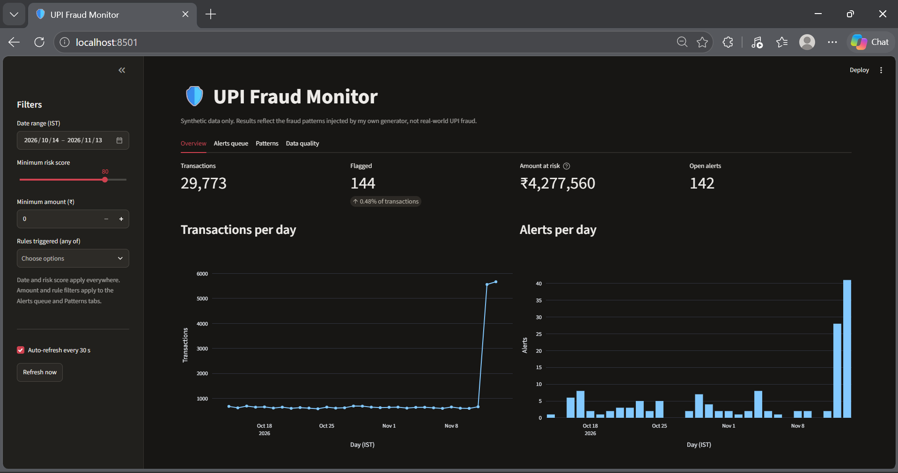
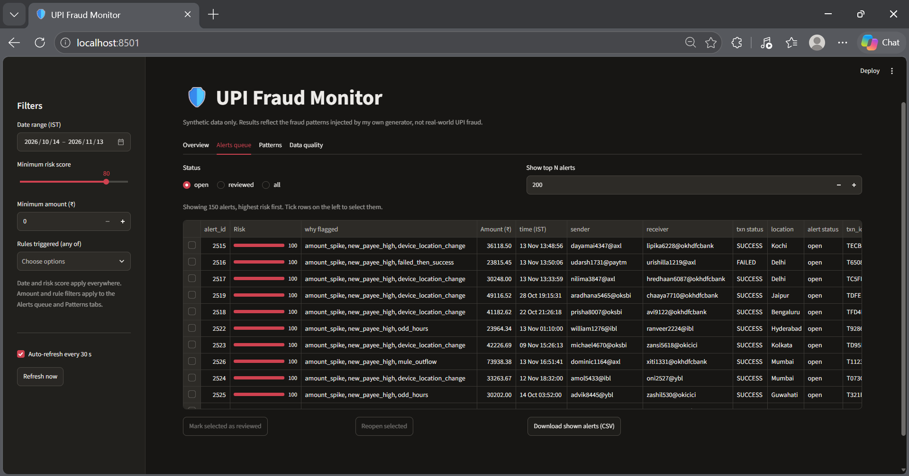
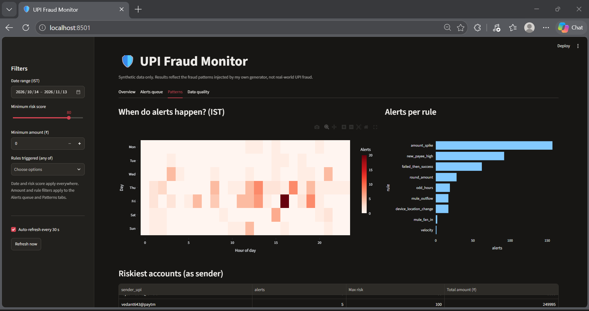
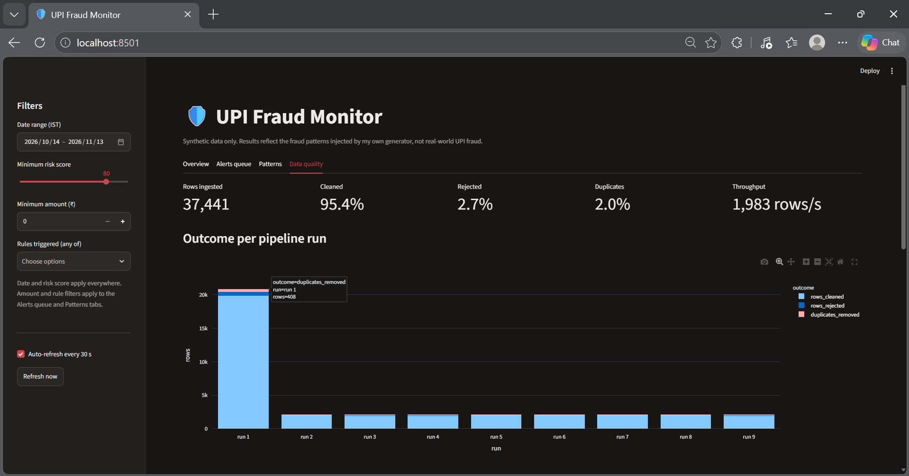
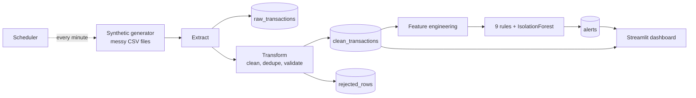

# UPI Fraud Detection Pipeline

An end-to-end data engineering project: messy UPI-style transaction files go in, get cleaned and stored in PostgreSQL, are scanned for fraud patterns, and show up on a live Streamlit dashboard where analysts see the riskiest transactions first.

**All data is synthetic.** It is generated by my own script, with known fraud injected, so detection can be measured honestly. No real transaction or personal data is used anywhere.

## The problem

Payment apps handle millions of transactions a day, and analysts cannot read them all. The raw data is also unreliable: duplicates from retries, missing fields, amounts written as "₹1,299.00" or "Rs. 1299", five different timestamp formats, and invalid UPI IDs.

This project solves two things:

1. **Messy data** becomes trustworthy, queryable data, and every bad row is kept with the reason it was rejected.
2. **Analyst overload** is reduced by ranking transactions by a risk score and showing why each one was flagged (for example "10 transactions in 5 minutes + new payee").

## Screenshots

| Overview | Alerts queue |
|---|---|
|  |  |

| Patterns | Data quality |
|---|---|
|  |  |

### Live mode

A scheduler generates, cleans and scores a new batch every minute, and the dashboard refreshes itself.


## How it works



**Database layers (PostgreSQL)**

| Table | Purpose |
|---|---|
| `raw_transactions` | Data exactly as received, all columns as text, duplicates kept |
| `clean_transactions` | Validated, typed, one row per `txn_id` |
| `rejected_rows` | Bad rows (stored as JSON) with the reason they failed |
| `user_features` | Per-user average and median amount, usual device and city |
| `alerts` | Flagged transactions with risk score, rules triggered, and open/reviewed status |
| `pipeline_runs` | One row per batch: rows in, cleaned, rejected, duplicates, duration |

## Tech stack

| Layer | Tools |
|---|---|
| Data generation | Python, Faker, NumPy |
| ETL | Python, pandas |
| Database | PostgreSQL, SQLAlchemy, psycopg2 |
| Detection | Rule engine (pandas), scikit-learn IsolationForest |
| Dashboard | Streamlit, Plotly |
| Scheduling | APScheduler |
| Testing | pytest |

## The messy data (on purpose)

The generator produces: duplicate rows (retries), missing device and location, amounts in several formats (`₹1,299.00`, `Rs. 1,299.00`, `1299`), five timestamp formats and time zones, inconsistent status values (`SUCCESS`, `success`, `Succ`, `Success `), invalid UPI IDs (`name@@bank`), negative amounts and future dates.

Fraud is injected in 8 patterns and recorded in a separate answer-key file that the pipeline never reads. Only the evaluation step uses it.

## Fraud rules

Each rule is a small, readable function with a weight. The weights add up to a rule score (0 to 100), so an analyst can see exactly why a transaction was flagged.

| Rule | Fires when | Weight |
|---|---|---|
| `velocity` | 10 or more transactions from one sender within 5 minutes | 40 |
| `amount_spike` | Amount is more than 5x the sender's median | 30 |
| `new_payee_high` | First payment to that receiver and amount of ₹20,000 or more | 45 |
| `mule_fan_in` | 8 or more different senders pay one account within an hour | 40 |
| `mule_outflow` | That account sends money out within an hour of the burst | 70 |
| `odd_hours` | Amount of ₹10,000 or more between 1:00 and 3:59 AM IST | 35 |
| `failed_then_success` | 3 or more failed attempts within 10 minutes, then a success | 45 |
| `device_location_change` | New device and new city compared to the sender's usual | 45 |
| `round_amount` | ₹9,999 / ₹49,999 / ₹99,999 repeated 3 or more times in an hour | 40 |

An **IsolationForest** (unsupervised anomaly detection) adds an anomaly score from 0 to 100.

`risk_score = 0.7 x rule score + 0.3 x anomaly score`

A transaction becomes an alert if any rule fired, or if its anomaly score is in the top 0.5%.

## Results

Run on one clean batch: 103,996 raw rows, 99,012 clean transactions, 1,907 of them real (injected) fraud. These numbers measure how well the system finds the patterns my generator injects. They are **not** a claim about real-world UPI fraud.

### Detection quality

| Metric | Value |
|---|---|
| Alerts raised | 1,729 |
| True positives / false positives / missed | 1,676 / 53 / 231 |
| **Precision** | **96.9%** |
| **Recall** | **87.9%** |
| F1 | 92.2% |
| False positive rate | 0.055% |
| **Precision@100** (top 100 alerts that are real fraud) | **100%** |
| Precision@200 | 100% |

In plain words: of the alerts raised, about 97 in 100 were real fraud, and about 88 in 100 of all fraud was caught. The top 200 alerts were all genuine fraud, which is what lets an analyst start at the top of the queue and trust it.

### Recall per fraud pattern

| Pattern | Fraud rows | Caught | Recall |
|---|---|---|---|
| mule | 639 | 639 | 100% |
| failed_then_success | 252 | 252 | 100% |
| round_amount | 196 | 196 | 100% |
| amount_spike | 50 | 50 | 100% |
| new_payee_high | 50 | 50 | 100% |
| odd_hours | 50 | 50 | 100% |
| device_location_change | 50 | 50 | 100% |
| velocity | 620 | 389 | 62.7% |

**All 231 missed fraud rows are velocity bursts.** The velocity rule flags a transaction only if it has 10 or more transactions in the 5 minutes before it or in the 5 minutes after it. Transactions in the middle of a short burst can fall just under that count, so only the start and end of the burst get flagged. Fixing this (flag every transaction inside a detected burst) is listed under future work.

### Rules vs IsolationForest vs combined

| Approach | Precision@100 | Average precision | ROC AUC |
|---|---|---|---|
| Rules only | 100% | 0.86 | 0.93 |
| IsolationForest only | 100% | 0.87 | 0.99 |
| **Rules + IsolationForest** | 100% | **0.98** | **1.00** |

Combining both clearly beats either one alone on ranking quality. The IsolationForest uses features built from the same signals as the rules (burst size, fan-in, device change), so its high score here is partly expected on synthetic data.

### Risk threshold trade-off

| Risk threshold | Alerts | Precision | Recall |
|---|---|---|---|
| 30 | 1,701 | 97.5% | 86.9% |
| 50 | 1,632 | 97.5% | 83.4% |
| 60 | 1,025 | 98.5% | 53.0% |
| 70 | 1,002 | 99.0% | 52.0% |

A higher threshold gives fewer, more certain alerts but misses more fraud. The dashboard has a risk slider so analysts can choose their own balance.

### Data quality (one pipeline run)

| Measure | Value |
|---|---|
| Rows ingested | 103,996 |
| Duplicates removed | 2,039 (1.96%) |
| Rows rejected and audited | 2,945 (2.83%) |
| Rows cleaned and loaded | 99,012 (95.21%) |
| Throughput | about 3,150 rows/second (33 s for the batch) |

Rejection reasons: invalid receiver UPI (984), invalid sender UPI (983), non-positive amount (490), future timestamp (462), and 26 rows with more than one problem.

### Query performance (1M rows)

Benchmarked on 1,000,000 synthetic transactions and about 20,000 alerts in a separate schema, queries filtering the last 7 days. Median of 7 runs. "Before" has primary keys only. Results are in `reports/benchmark.md`.

| Query | Before | After | Speed-up |
|---|---|---|---|
| Alerts queue (top 200 open) | 111.5 ms | 6.9 ms | **16x** |
| Account lookup (analyst drill-down) | 65.8 ms | 0.4 ms | **147x** |
| Riskiest accounts | 125.6 ms | 55.4 ms | 2.3x |
| Overview KPIs | 117.7 ms | 61.4 ms | 1.9x |
| Alerts queue + rule filter | 16.3 ms | 11.6 ms | 1.4x |
| Daily trend | 187.1 ms | 207.3 ms | no gain |

One full dashboard refresh (5 queries) went from 558 ms to 343 ms (1.6x faster). The daily trend query did not improve because it still has to read a full week of data, so an index cannot help much. The five indexes add about 103 MB of storage (146 MB to 249 MB) and make writes slightly slower.

## Run it yourself

Tested with Python 3.11 and PostgreSQL 18 on Windows.

**1. Clone and install**

```bash
git clone https://github.com/Siddheshp15/upi-fraud-pipeline.git
cd upi-fraud-pipeline
python -m venv venv
venv\Scripts\activate          # Mac/Linux: source venv/bin/activate
pip install -r requirements.txt
```

**2. Create the database** (run in psql or pgAdmin's Query Tool as the `postgres` user, one statement at a time)

```sql
CREATE USER upi_user WITH PASSWORD 'upi_pass';
CREATE DATABASE upi_fraud OWNER upi_user;
```

**3. Configure**

Copy `.env.example` to `.env` and set the password you chose.

**4. Create the tables and indexes**

```bash
python -m src.init_db
```

**5. Generate data, then run the pipeline**

```bash
python -m src.generator.generate --n 100000 --days 30
python -m src.pipeline
python -m src.detection.scoring
python -m src.evaluation.evaluate      # writes reports/metrics.md
```

**6. Open the dashboard**

```bash
streamlit run dashboard/app.py
```

**7. Optional: live mode** (in a second terminal)

```bash
python -m src.scheduler --every 1
```

Every minute this generates a batch, cleans and loads it, re-scores all transactions, and the dashboard picks up the changes. Use `--once` to run a single cycle, or `--no-generate` to process only files you drop into `data/incoming/`.

**8. Optional: benchmark**

```bash
python -m src.benchmark          # about 2-5 minutes, uses a separate "perf" schema
python -m src.benchmark --drop   # remove the test data afterwards
```

**Tests**

```bash
python -m pytest -v
```

## Project structure

```
upi-fraud-pipeline/
├── sql/
│   ├── 01_schema.sql          # tables
│   └── 02_indexes.sql         # indexes used by the dashboard
├── src/
│   ├── config.py              # database URL and paths
│   ├── init_db.py             # creates tables and indexes (--reset to wipe)
│   ├── generator/generate.py  # messy data + injected fraud + answer key
│   ├── etl/                   # extract.py, transform.py, load.py
│   ├── detection/             # features.py, rules.py, anomaly.py, scoring.py
│   ├── evaluation/evaluate.py # precision, recall, Precision@K, per-pattern recall
│   ├── pipeline.py            # one batch: extract, clean, load, log
│   ├── scheduler.py           # runs the whole cycle every N minutes
│   └── benchmark.py           # 1M-row before/after index timing
├── dashboard/app.py           # Streamlit app (4 tabs)
├── tests/                     # unit tests
├── reports/                   # metrics.md and benchmark.md
└── docs/                      # screenshots
```

## Dashboard

- **Overview:** total transactions, flagged count and percentage, amount at risk, open alerts, daily trends.
- **Alerts queue:** alerts ranked by risk with the rules that fired. Select rows and mark them reviewed (saved to PostgreSQL), or download as CSV.
- **Patterns:** hour-by-day heatmap, alerts per rule, riskiest accounts, suspected mule accounts.
- **Data quality:** rows cleaned, rejected and duplicated for every run, plus rejection reasons.

The sidebar filters by date, minimum risk, minimum amount and rule, and the page refreshes every 30 seconds.

## Design decisions

- **Raw layer is all text.** Nothing can fail on load, and the original data is always preserved.
- **Idempotent loads.** `clean_transactions` uses `txn_id` as the primary key with `ON CONFLICT DO NOTHING`, so re-running a file never creates duplicates.
- **One transaction per batch.** If anything fails, the batch is rolled back, and the failure is still recorded in `pipeline_runs`.
- **Explainable rules first.** Analysts need to know why a transaction was flagged, so every alert lists the rules that fired. ML only adds a second score.
- **Median instead of average** for the amount-spike rule, because fraud pulls the average up.
- **Explicit date formats.** The `dd/mm/yyyy` format is parsed explicitly to avoid silently swapping day and month. Timestamps without a time zone are treated as IST and everything is stored in UTC.
- **Answer key kept separate.** The pipeline never sees the fraud labels, so evaluation is honest.
- **Invalid values only on non-fraud rows.** Bad UPI IDs, negative amounts, future dates and nulls are injected only into non-fraud rows, so every fraud row survives cleaning and recall stays measurable.

## Limitations

- **Synthetic data.** Results show how well the system finds the patterns my generator injects, not how it would do on real fraud, which is far messier.
- **Rules were written to match the injected patterns**, so scores look high. Rule weights and the 0.7/0.3 blend were chosen by hand, not tuned.
- **Velocity recall is 62.7%** for the reason explained above.
- `mule_outflow` is the least precise rule (68%), and anomaly-only alerts are about 64% precise.
- **Scoring recomputes features over the whole table** every cycle. That is fine at this size, but at millions of real rows it would need incremental scoring.
- The 1M-row benchmark data was generated directly in SQL to test query speed. It says nothing about detection quality.
- The dashboard has no login, and the project runs on a single machine.

## Future work

- Flag every transaction inside a detected velocity burst
- Supervised model (XGBoost) trained on labels, with SHAP explanations
- Graph analysis (NetworkX) for mule networks
- Incremental scoring for new transactions only
- Docker Compose for one-command setup, and cloud deployment with CI

## Author

Siddhesh ([@Siddheshp15](https://github.com/Siddheshp15))
